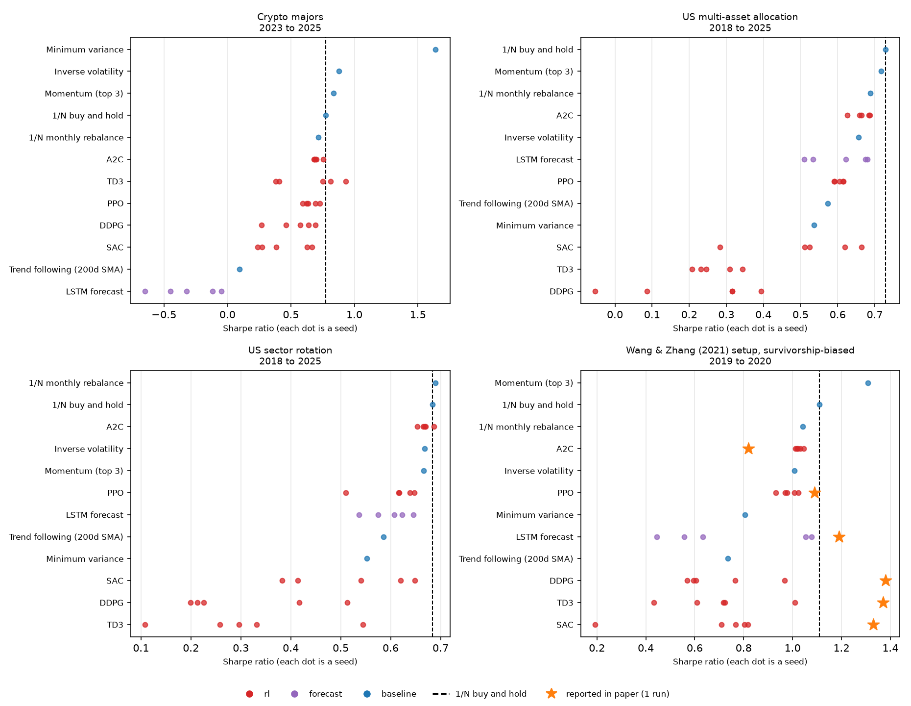

# RL-pricing: can deep RL beat 1/N?

[](https://github.com/BichengWang/RL-pricing/actions/workflows/tests.yml)
[](https://github.com/BichengWang/RL-pricing/actions/workflows/bench.yml)
[](https://arxiv.org/abs/2609.31870)
[](LICENSE)

An honest benchmark for reinforcement-learning portfolio policies. Every
policy (deep RL, forecasters, rules, your idea) is traded by the same causal
execution model on survivorship-free universes, scored over several seeds
against equal weighting, and then frozen and scored **live** on market data
that did not exist when it was published.



## Findings so far

Historical track, test windows 2018–2025 (US ETFs) and 2023–2025 (crypto),
untuned Stable-Baselines3 agents, 5 seeds each:

- **No learned policy beats 1/N buy-and-hold.** All 24 RL and LSTM entries
  across the four tasks have a lower seed-averaged Sharpe ratio than holding
  every asset in equal weight. Only 3 of their 120 individual seeds do better,
  so cherry-picking one would make a publishable-looking result.
- **The off-policy agents churn themselves to death.** SAC, TD3 and DDPG
  turn over 46–326× their equity per year. On the US tasks their alpha
  against 1/N is negative, with *t*-statistics down to −2.8.
- **A2C rediscovers 1/N.** Its five seeds on US sectors land at Sharpe
  0.67 ± 0.01 against 1/N's 0.68: the softmax policy learns to stay close to
  equal weights.
- **The one significant win is not RL.** In crypto, long-only minimum
  variance beats 1/N (ΔSharpe +0.86, bootstrap p < 0.001), mostly by holding
  the two least volatile coins, BTC (50% on average) and BNB (36%).
- **Our own paper does not survive.** See [below](#re-evaluating-our-own-paper).

These are reference agents with default hyperparameters (`trials: 1`).
Better-tuned submissions are exactly what the leaderboard is for, and they
are welcome.

## Leaderboard

<!-- leaderboard:start -->
| Track | Task | # | Strategy | Sharpe | CAGR | Max DD | ΔSharpe vs 1/N | DSR |
| --- | --- | --- | --- | --- | --- | --- | --- | --- |
| historical | `crypto-majors` | 1 | Minimum variance | 1.64 | 90.9% | -33.3% | +0.86 (p<0.001) | 1.00 |
| historical | `crypto-majors` | 2 | Inverse volatility | 0.88 | 40.7% | -46.8% | +0.10 (p=0.089) | 0.94 |
| historical | `crypto-majors` | 3 | Momentum (top 3) | 0.84 | 37.8% | -47.9% | +0.06 (p=0.401) | 0.93 |
| historical | `crypto-majors` | 4 | **1/N buy and hold** ◆ | 0.78 | 32.7% | -44.5% | – | 0.91 |
| historical | `crypto-majors` | 6 | A2C | 0.70 ± 0.03 | 26.4% | -45.6% | -0.07 (p=0.822) | 0.89 |
| historical | `us-multi-asset` | 1 | **1/N buy and hold** ◆ | 0.73 | 8.9% | -26.6% | – | 0.98 |
| historical | `us-multi-asset` | 2 | Momentum (top 3) | 0.72 | 9.9% | -23.7% | -0.01 (p=0.506) | 0.98 |
| historical | `us-multi-asset` | 3 | 1/N monthly rebalance | 0.69 | 8.0% | -25.8% | -0.04 (p=0.827) | 0.97 |
| historical | `us-multi-asset` | 4 | A2C | 0.66 ± 0.02 | 7.1% | -23.8% | -0.06 (p=0.940) | 0.97 |
| historical | `us-sectors` | 1 | 1/N monthly rebalance | 0.69 | 11.6% | -36.7% | +0.01 (p=0.449) | 0.97 |
| historical | `us-sectors` | 2 | **1/N buy and hold** ◆ | 0.68 | 11.5% | -35.5% | – | 0.97 |
| historical | `us-sectors` | 3 | A2C | 0.67 ± 0.01 | 10.3% | -34.3% | -0.01 (p=0.650) | 0.97 |
| historical | `paper-2021` (re-evaluation) | – | Momentum (top 3) | 1.31 | 48.6% | -30.4% | +0.20 (p=0.240) | 0.96 |
| historical | `paper-2021` (re-evaluation) | – | **1/N buy and hold** ◆ | 1.11 | 29.9% | -29.4% | – | 0.94 |
| historical | `paper-2021` (re-evaluation) | – | 1/N monthly rebalance | 1.04 | 26.7% | -29.5% | -0.07 (p=0.777) | 0.93 |
| historical | `paper-2021` (re-evaluation) | – | A2C | 1.03 ± 0.01 | 25.1% | -28.2% | -0.08 (p=0.825) | 0.92 |

Full tables: [leaderboard/LEADERBOARD.md](leaderboard/LEADERBOARD.md).
<!-- leaderboard:end -->

## Why trust these numbers

| | This benchmark | Common in RL-trading papers |
| --- | --- | --- |
| Execution | Decide at the close, fill at the next open, proportional fees | Fill at the same close used to decide; often no fees |
| Universe | Fixed ETFs; crypto top-10 by volume *before* the data starts, delistings included | Today's index members, back-tested into the past |
| Randomness | 5 seeds per learned policy, mean ± sd, every seed plotted | One run |
| Model selection | Validation window before the test; declared `trials` deflate the Sharpe | Tuned on the test period |
| Out-of-sample | Live track: frozen policy, scored only on sessions after its public freeze | One fixed historical window |
| Metrics | One implementation for everyone; beta and alpha against 1/N | Per-paper definitions |

The live track is the part nobody can overfit. A policy is fitted on all
data available today and its artifacts are committed with SHA-256 hashes. A
CI job on `main` then stamps the time the freeze became public
(`leaderboard/publications.json`, which pull requests may not edit), and
from then on it is scored monthly on sessions that start after that stamp.
The first live scores appear after the next monthly run.

## Re-evaluating our own paper

Our preprint ([Wang & Zhang, arXiv:2609.31870](https://arxiv.org/abs/2609.31870))
reported DDPG with a 55.5% annual return and Sharpe 1.38 on 20 large-cap
stocks in 2019–2020, with TD3 and SAC close behind. Those are single runs on a
universe picked in 2021 from the largest companies, which the paper itself
lists as limitations.

The `paper-2021` task re-runs that setup (same 20 stocks, same 2019–2020
test window, 0.1% fees) under this benchmark's execution model with 5 seeds:

| Agent | Reported Sharpe (1 run) | Here: mean ± sd (5 seeds) | Here: best seed |
| --- | --- | --- | --- |
| DDPG | 1.38 | 0.70 ± 0.17 | 0.97 |
| TD3 | 1.37 | 0.70 ± 0.21 | 1.01 |
| SAC | 1.33 | 0.66 ± 0.26 | 0.82 |
| PPO | 1.09 | 0.98 ± 0.04 | 1.02 |
| A2C | 0.82 | 1.03 ± 0.01 | 1.05 |
| LSTM forecast | 1.19 | 0.75 ± 0.29 | 1.08 |
| *1/N buy and hold* | – | *1.11* | – |

Simply holding the 20 stocks in equal weight earned 29.9% a year at Sharpe
1.11, so much of the reported return came from the hindsight-chosen universe
and a bull market. No seed of any agent beat that. This is not an exact
reproduction: the agents here allocate portfolio weights instead of trading
share counts, and use this benchmark's features and default hyperparameters.
The comparison shows how much a single run's result can move under stricter
evaluation; it does not prove the paper's runs were wrong.

## Quick start

Python 3.10 or newer:

```bash
git clone https://github.com/BichengWang/RL-pricing.git
cd RL-pricing
python -m venv .venv && source .venv/bin/activate
python -m pip install -e .

rl-pricing bench tasks                       # list tasks
rl-pricing bench run --task synthetic --submission momentum --out-root /tmp/board
rl-pricing bench run --task synthetic --submission ppo --seeds 2 --out-root /tmp/board
rl-pricing bench leaderboard --out-root /tmp/board --no-readme
```

The `synthetic` task is offline random walks with no edge by construction.
Real tasks download data on first use (`rl-pricing bench data us-sectors`)
into `datasets/bench/`. PPO takes one to two minutes per seed on a laptop CPU.

## Submit a policy

A policy maps the history up to today's close to long-only target weights,
which fill at the next open. Here is a complete one:

```python
# submissions/low-vol-half/policy.py
import numpy as np

from rl.bench.policy import Policy


class LowVolHalf(Policy):
    """Equal-weight the calmer half of the listed assets."""

    def act(self, view):
        closes = view.history.window(64).close
        vol = np.nanstd(np.diff(np.log(closes), axis=0), axis=0)
        vol = np.where(view.listed & np.isfinite(vol), vol, np.inf)
        keep = np.argsort(vol)[: max(1, view.listed.sum() // 2)]
        weights = np.zeros(len(view.tickers))
        weights[keep] = 1 / len(keep)
        return weights
```

```json
{
  "name": "Low-vol half",
  "kind": "other",
  "policy": "policy.py:LowVolHalf",
  "trials": 3,
  "authors": ["Your Name"],
  "description": "Equal-weight the half of the assets with the lowest 63-day volatility."
}
```

Learning policies implement `fit(history, validation_start, seed)` as well:
train on sessions before `validation_start`, select on the rest, and set
`stochastic = True` to be evaluated over several seeds. They also implement
`save`/`load` so the frozen live version can be restored. See
[`rl/bench/policies/sb3.py`](rl/bench/policies/sb3.py) for a full example.
Set `trials` honestly to the number of configurations you tried.

Then:

1. `rl-pricing bench validate` and `rl-pricing bench run --task <task> --submission <id>` locally.
2. Open a pull request with `submissions/<id>/` and your `leaderboard/historical/` records.
   CI checks that the submission builds and the baselines reproduce.
3. On merge, CI freezes the policy on today's data (or publishes your
   committed freeze from `rl-pricing bench freeze`) and the monthly job scores
   it live from then on.

## Tasks

| Task | Universe | Test window | Fee per side | Why it is survivorship-free |
| --- | --- | --- | --- | --- |
| `us-sectors` | 9 SPDR sector ETFs | 2018–2025 | 5 bps | all listed since 1998 |
| `us-multi-asset` | SPY, QQQ, IWM, EFA, EEM, TLT, IEF, LQD, GLD, VNQ | 2018–2025 | 5 bps | all listed since 2004 |
| `crypto-majors` | top 10 Binance USDT pairs by Q2-2018 volume | 2023–2025 | 10 bps | chosen before the data starts; BCC and EOS delist mid-sample |
| `paper-2021` | the 2021 paper's 20 large caps | 2019–2020 | 10 bps | *it is not*: shown as a re-evaluation, not ranked |
| `synthetic` | 5 random walks | 2018–2019 | 10 bps | offline demo |

Each task trains before its validation window, selects on validation, and
reports the test window. Definitions live in [`rl/bench/tasks.py`](rl/bench/tasks.py).

## How scoring works

- **Execution** ([`rl/bench/engine.py`](rl/bench/engine.py)): targets set at
  close *t* fill at open *t+1* with fees solved exactly on traded notional.
  Weights are long-only and sum to at most one; the rest is cash at 0%. A
  delisted holding is sold at its last close. RL agents train in a gym
  environment that uses the same `Account`, so training and evaluation
  accounting are identical.
- **Metrics** ([`rl/bench/scoring.py`](rl/bench/scoring.py)): Sharpe, CAGR,
  max drawdown, annual turnover, and beta/alpha against 1/N (Newey-West *t*).
  ΔSharpe against 1/N comes with a paired stationary-bootstrap p-value. The
  deflated Sharpe ratio (Bailey & López de Prado) accounts for declared
  `trials`. Full definitions are in [`leaderboard/LEADERBOARD.md`](leaderboard/LEADERBOARD.md).
- **Records**: every run stores its daily equity curve per seed, data
  SHA-256, software versions and commit under `leaderboard/`, so all
  metrics can be recomputed.

## Data

US tasks use Yahoo Finance adjusted prices downloaded to a local cache.
Yahoo's terms prohibit redistribution, so the repository ships no prices,
only derived results. Adjusted history changes as dividends are paid, and
records note when a data hash changes. Crypto uses
[Binance Vision](https://data.binance.vision) daily klines, each archive
verified against Binance's SHA-256 checksum. Binance Vision data is licensed
CC BY-NC-SA 4.0; the crypto results here derive from it, with attribution,
for non-commercial research.

## Limitations

- Fees are proportional; spread, market impact and borrowing costs are not
  modeled, and cash earns nothing.
- Daily bars only; adjusted prices model reinvested distributions rather
  than exact exchange fills.
- Eight-year and three-year test windows are a few market regimes, which is
  why the live track exists.
- Reference RL agents are untuned and use one feature set
  ([`rl/bench/features.py`](rl/bench/features.py)); they are a floor, not
  the best RL can do.

## Training toolkit

The original FinRL-style training pipeline (share trading, portfolio
allocation, LSTM forecaster, rolling ensemble via `python main.py --mode ...`)
is still available and documented in [`docs/toolkit.md`](docs/toolkit.md).

## Development

```bash
pip install -e ".[test,lint]"
python -m pytest        # offline: synthetic data and fixtures
ruff check .
```

Use `type(scope): title` for pull request titles. The
[PR template](.github/pull_request_template.md) asks for a short summary and
verification results.

## Citing

GitHub's "Cite this repository" uses [`CITATION.cff`](CITATION.cff). The
original study is Wang & Zhang, *Deep Reinforcement Learning for Equity
Trading: Benchmarking Actor-Critic Methods with Forward Retraining*,
[arXiv:2609.31870](https://arxiv.org/abs/2609.31870)
([local PDF](docs/Wang_Zhang_2021_Deep_Learning_Stock_Trading_arxiv.pdf)).

## License

MIT; see [LICENSE](LICENSE). The training toolkit's environment,
preprocessing and training code are adapted from the MIT-licensed
[FinRL](https://github.com/AI4Finance-Foundation/FinRL) library.
